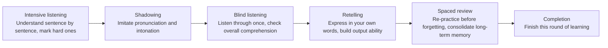

<div align="right">
  <strong>English</strong> | <a href="./README.md">简体中文</a>
</div>

<div align="center">
  

  <h1>Echo Loop — Efficient English Listening & Speaking Training</h1>

  <p><strong>You no longer have to figure out how to practice English on your own.</strong></p>

  <p>Intensive listening · Shadowing · Blind listening · Retelling · Review — Echo Loop guides you through every step at a scientifically-paced rhythm.</p>

  <p><sub><em>This project is academically advised by <a href="https://sfs.muc.edu.cn/info/1063/3729.htm"> Yang Yan</a> from the School of Foreign Studies, Minzu University of China.</em></sub></p>

  <p>
    <a href="./LICENSE"></a>
    
    <a href="https://github.com/echo-loop/Echo-Loop/releases/latest"></a>
    <a href="https://github.com/echo-loop/Echo-Loop/releases"></a>
    <a href="https://github.com/echo-loop/Echo-Loop/commits/main"></a>
  </p>

  <p>
    <a href="https://trendshift.io/repositories/41519?utm_source=trendshift-badge&amp;utm_medium=badge&amp;utm_campaign=badge-trendshift-41519" target="_blank" rel="noopener noreferrer"></a>
  </p>

  <p>
    <a href="https://github.com/echo-loop/Echo-Loop/releases"></a>
  </p>
</div>

---

## 📱 Screenshots

<table>
  <tr>
    <td align="center"><br/><sub>Import audio, start practicing</sub></td>
    <td align="center"><br/><sub>Scientific practice, listen-speak loop</sub></td>
    <td align="center"><br/><sub>Auto reminders, visible progress</sub></td>
    <td align="center"><br/><sub>Sentence-by-sentence intensive listening</sub></td>
    <td align="center"><br/><sub>Sense-group split, hard sentence analysis</sub></td>
  </tr>
  <tr>
    <td align="center"><br/><sub>Retelling: turn comprehension into output</sub></td>
    <td align="center"><br/><sub>Saved hard sentences, practice to mastery</sub></td>
    <td align="center"><br/><sub>Flashcard review with original context</sub></td>
    <td align="center"><br/><sub>Practice freely at your own pace</sub></td>
    <td align="center"></td>
  </tr>
</table>

---

## ✨ Features

- 🤖 **Auto-driven learning rhythm**: Shadowing repetitions, review timing, and hard-sentence marking all advance automatically — you just focus on listening and speaking.
- 🎯 **Listen-speak loop**: Intensive listening, shadowing, and retelling flow seamlessly. From understanding the content, to imitating expression, to saying it in your own words.
- 🧩 **Sense-group splitting for long sentences**: Long sentences are split by sense groups, breaking complex structures into digestible chunks.
- ⭐ **Save hard sentences and review them on demand**: Hard sentences are auto-archived for focused shadowing and repeated practice — no more "marked and forgotten".
- 📚 **Contextualized flashcard review**: Saved words and sense groups are reviewed alongside their original sentence context — memorize in context, not in isolation.
- 💡 **AI translation, analysis, and vocabulary explanation (BYOK)**: Bilingual translation, sentence analysis, word usage and collocations with your own OpenAI-compatible provider key — expand on demand without breaking your flow.
- 📍 **Resume where you left off**: Automatically records your stage and current sentence, so you can pick up instantly — even 5-minute fragments count.
- 📊 **Learning statistics**: Tracks practice time, input/output ratio, and unique vocabulary — see exactly how much you've practiced and spoken.
- 🎙️ **AI shadowing evaluation**: Automatically aligns ASR results with the original text, highlights matched words, and gives a shadowing rating.
- 🗣️ **AI speaking practice (Android, BYOK)**: Four tiers of free conversation — Beginner press-to-talk, Intermediate VAD turn-taking, Advanced voice barge-in, and Expert speech-to-speech; LLM support for DeepSeek, Alibaba Cloud Bailian, OpenAI, and custom OpenAI-compatible providers; ASR and TTS can be cloud or on-device depending on the tier, with selectable TTS voices, and every tier keeps its own settings. See "AI speaking practice: four tiers" below.
- 🎧 **Local audio import + offline subtitles**: Batch-import local audio, import existing subtitles, or generate subtitles with the on-device model.

---

## 🗣️ AI speaking practice: four tiers

This is a complete module added in this fork, not just a chat box with a microphone attached: it makes four explicit choices about when you start talking, when your turn ends, whether you can interrupt the AI, and which speech models run the conversation. All four tiers share the same conversation screen, message history, and BYOK credentials; switching tiers does not wipe your settings.

### Which tier should I use?

| Tier | Start / end | Turn detection | Voice barge-in | Speech pipeline | Best for |
|---|---|---|---|---|---|
| **Beginner** | Tap the mic to talk, then tap Finish to submit | Manual submit | No | ASR / TTS on-device or cloud; LLM via BYOK | First conversations; thinking before speaking |
| **Intermediate** | Tap Start conversation, then tap End conversation | Local VAD, end-of-speech silence | No | Same | Longer conversations without echo or network distractions |
| **Advanced** | Same as Intermediate | Local VAD + barge-in detection | Yes, speak while the AI talks | Cloud realtime ASR + cloud TTS; LLM via BYOK | Real conversation timing on a stable network |
| **Expert** | Tap Start conversation, then tap End conversation | Server-side (`smart_turn_v2`, or `server_vad` 800ms) | Yes | One speech-to-speech model, no ASR → LLM → TTS chain | Lowest latency and the most natural turn-taking |

> Not sure? Start with Beginner to get comfortable speaking, move to Intermediate for longer conversations, use Advanced when you want to practice reacting to interruptions, and try Expert when your network and model access are ready.

### Settings are isolated per tier

The **Settings › Speaking Engine** page has four tabs: Beginner, Intermediate, Advanced, and Expert. **Switching tabs only edits that tier; it does not change the tier you are currently practicing with.**

- Each tier stores its ASR source (AI / on-device), TTS source (AI / on-device), ASR model, TTS voice, speaking rate, autoplay, end-of-speech silence, idle exit, and barge-in sensitivity independently.
- Configuration keys carry a tier suffix, such as `ai_speaking_tts_model_advanced` and `speaking_dialog_end_of_speech_ms_expert`; reads fall back from the tier key to the legacy global key and then to the default, so upgrades do not lose settings.
- The LLM provider / model / temperature, DashScope key, and workspace are shared globally under **AI Settings**.
- Non-Expert tiers offer recognition models such as `qwen-audio-3.1-asr-flash-streaming`, `qwen-audio-3.0-asr-flash-streaming`, and `qwen-audio-3.1-asr-flash`; TTS models are `qwen-audio-3.1-tts-flash` (the default recommendation) and `qwen-audio-3.1-tts-plus`, with selectable voices. Choosing on-device ASR in Advanced warns that cloud realtime ASR is required.
- Expert hides the ASR / TTS source pickers and shows a realtime voice card instead: model `qwen-audio-3.1-realtime-flash` (default) / `qwen-audio-3.1-realtime-plus`, voice, and turn-detection strategy live in that card; changing the model falls back to a valid voice.

### One shared conversation engine

- **Turn-taking**: `VadTurnDetector` uses an adaptive energy threshold (the larger of the base threshold and noise floor × 3), 180ms debounce, and end-of-speech silence to decide when an utterance ends. End-of-speech silence is configurable from 400–2000ms, with a 2-second hard cap.
- **Recognition**: cloud ASR streams continuously and replays up to 5 seconds of preroll audio to cover the gap before the connection is ready, so the first words are not lost; on-device recognition uses whole-utterance or near-streaming paths.
- **Speech**: sentence-level streaming TTS splits the first sentence early; Android plays it through `PcmStreamPlayer` / AudioTrack as it arrives, cutting the wait for the first sentence.
- **Barge-in**: on speaker output, Advanced first ducks the TTS volume and briefly mutes it to check whether the voice is really the user; if it cannot decide reliably, voice barge-in is disabled and manual stop remains, so speaker echo is never mistaken for input. Expert handles interruption server-side in the realtime model and discards late audio chunks by `response_id`.
- **Recording**: AEC and noise suppression reduce speaker echo; barge-in mode disables AGC so ducked echo is not amplified again.

---

## 🤔 Why we built this

When using other English-learning apps, you have to decide for yourself: how many times should I listen today? Intensive or extensive? Which sentence haven't I mastered yet? Should I shadow it? When should I review?

**Those decisions themselves are what drains your willpower** — it's not that you can't understand, it's that you don't know what to do next.

Echo Loop takes those decisions off your plate. Pick a piece of audio you want to understand, hit start, and from intensive listening to completion, every step tells you "what to do right now".

You just need to keep opening the app — Echo Loop handles the rest. Practicing one piece thoroughly beats listening to 100 random ones.

---

## 🆚 How it differs from other solutions

We picked four English-learning apps most familiar to Chinese learners for comparison. Each individual feature exists, more or less, in other apps. But Echo Loop's real difference is this: **it strings every step together and drives you through automatically — you don't need to figure out the method, control repetition counts, or manage review intervals yourself.**

| Feature | Echo Loop | Daily English Listening | Kekenet | Liulishuo | Anki |
|---|---|---|---|---|---|
| **App-driven learning rhythm** | ✅ Fully automatic | ❌ | ❌ | ❌ | ❌ |
| Listen → speak loop (intensive + shadowing + **retelling**) | ✅ | ⚠️ Partial | ⚠️ Partial | ⚠️ Partial | ❌ |
| **Sense-group splitting for long sentences** | ✅ | ❌ | ❌ | ❌ | ❌ |
| **Saved-sentence focused review** | ✅ | ❌ | ❌ | ❌ | ❌ |
| **Contextualized flashcard review** | ✅ | ❌ | ❌ | ❌ | ⚠️ Manual cards required |
| AI translation / sentence analysis / word deep-dive | ✅ | ⚠️ Partial | ⚠️ Partial | ❌ | ❌ |
| **Resume where you left off** | ✅ | ⚠️ Partial | ⚠️ Partial | ⚠️ Partial | ⚠️ Partial |
| Stats: time / input-output ratio / unique vocabulary | ✅ | ⚠️ Partial | ⚠️ Partial | ⚠️ Partial | ❌ |
| AI shadowing evaluation | ✅ | ✅ | ✅ | ✅ | ❌ |
| Local audio import | ✅ | ✅ | ❌ | ❌ | ⚠️ Manual cards |
| Offline available | ✅ | ✅ | ✅ | ⚠️ Partial | ✅ |
| Open source | ✅ | ❌ | ❌ | ❌ | ✅ |

---

## 🧠 Methodology

**Intensive listening → Shadowing → Blind listening → Retelling → Spaced review → Completion.**



**Every step above is auto-driven by Echo Loop — no judgment calls required.**

You don't need to manage "how many times should I listen" or "is it time to review last week's material". Open the app, and what to do today appears right in front of you.

The full process is quantified: **practice time · input/output ratio · unique vocabulary**.

<details>
<summary><strong>How are spaced reviews scheduled?</strong></summary>

Each piece of material is split into 1 first-pass session + 7 spaced reviews. Intervals stretch from 6 hours to 28 days, hitting the memory trace just before forgetting — aligned with the Ebbinghaus forgetting curve.

| Stage | Interval since last | Tasks |
|---|---|---|
| First pass | — | Intensive → Shadowing → Blind → Retelling |
| Review 1 | After 6 hours | Hard-sentence drills + retelling |
| Review 2 | After 1 day | Blind listening + drills + retelling |
| Review 3 | After 2 days | Blind listening + drills + retelling |
| Review 4 | After 4 days | Blind listening + drills + retelling |
| Review 5 | After 7 days | Blind listening + drills + retelling |
| Review 6 | After 14 days | Blind listening + drills + retelling |
| Review 7 | After 28 days | Blind listening + drills + retelling |

</details>

---

## 📥 Download & try it

This branch ships **Android APK only**. Download it from [GitHub Releases](https://github.com/echo-loop/Echo-Loop/releases). The upstream App Store and Google Play builds do not include this branch's on-device changes.

- No account, sign-in, or subscription
- Learning data stays on your device, with local backup and restore
- AI features connect directly to your own OpenAI-compatible provider key

---

## ❓ FAQ

<details>
<summary><strong>Is Echo Loop free?</strong></summary>

All core features are free, with no usage caps and no item limits:

- **Unlimited imports**: local files, direct audio links, and podcast sources you add yourself
- **Unlimited favorites**: save as many hard sentences, words and sense groups as you like
- **The full learning loop**: intensive listening, shadowing, blind listening and retelling, plus 7 rounds of spaced review with reminders
- **Focused review of hard sentences + in-context flashcards**
- **Shadowing evaluation**: runs on your device's built-in speech recognition, with no usage count
- **Offline transcription**: download a model and generate subtitles on your device, no account needed
- **Offline dictionary, learning statistics, PDF note export, backup & restore**

Everything is free — no account, subscription, or usage quota. AI features use BYOK: add your own provider API key in Settings, and the provider bills you directly for what you use.

</details>

<details>
<summary><strong>Which features need my own API key?</strong></summary>

AI translation, sentence analysis, sense-group splitting, word analysis, the AI study assistant, and AI speaking practice (all four tiers) need an OpenAI-compatible provider API key configured in Settings. All local features work without a connection or a key.

</details>

<details>
<summary><strong>Can I still use it without an API key?</strong></summary>

Yes. Intensive listening, shadowing, blind listening, retelling, saved-sentence review, on-device transcription, and backup all work normally. Add your key in Settings when you want AI explanations or AI speaking practice.

</details>

<details>
<summary><strong>Why do I pay for AI usage in an open-source project?</strong></summary>

The code is fully open source (AGPL-3.0). The app has no self-hosted backend and no membership markup: AI requests go directly from your device to the provider you choose, and the provider bills you for your actual usage.

</details>

<details>
<summary><strong>Which platforms are supported?</strong></summary>

This fork's on-device-first build is **Android only**. Download the APK from [Releases](https://github.com/echo-loop/Echo-Loop/releases). The upstream App Store and Google Play builds do not include this fork's on-device changes.

</details>

<details>
<summary><strong>How is it different from other English apps?</strong></summary>

Other apps mostly give you materials and tools and leave it to you to work out how to practice. Echo Loop handles the *how*: intensive listening, shadowing, blind listening, retelling and spaced review run as a single flow, and the app tells you what to do at every step. You don't need to make a plan, count repetitions or track review dates. See "🆚 How it differs from other solutions" above for a detailed comparison.

</details>

<details>
<summary><strong>What materials are supported?</strong></summary>

- **Audio**: mp3, m4a, wav, aac, flac
- **Video**: mp4, mov, m4v, mkv (you can hide the picture and practice with audio only)
- **Subtitles**: srt, vtt, lrc; subtitle files with the same name as the audio are paired automatically. No subtitles? Generate them with AI transcription
- **Sources**: local files, direct audio links, and podcast sources you add yourself

Podcasts, TED talks, TV clips and textbook audio all work. For best results, pick content **you're interested in and that's slightly above your current level**.

</details>

<details>
<summary><strong>What English level do I need?</strong></summary>

If you can follow the gist of a material with subtitles, you're ready. When a sentence is hard to follow, break it down with sense-group splitting, AI translation and sentence analysis. If you're still building your basics, start with short, slow-paced materials.

</details>

<details>
<summary><strong>How soon will I see results?</strong></summary>

After the first study session on a material, you'll understand it and be able to retell it in your own words. The 7 rounds of spaced review that follow take about 8 weeks and lock it into long-term memory. Overall listening and speaking skills build up over time: practice 20–30 minutes a day with 2–3 materials at once, and within a few weeks listening should feel easier and speaking more fluent.

</details>

<details>
<summary><strong>Can I use it offline?</strong></summary>

Yes. The learning flow, reviews, favorites, shadowing evaluation, on-device transcription, and backup all work offline. Only AI explanations, AI speaking practice, and online podcast sources need a connection.

</details>

<details>
<summary><strong>Which AI speaking tier should I choose?</strong></summary>

Beginner is for first conversations: speak, then submit. Intermediate keeps a conversation going with VAD turn-taking. Advanced lets you interrupt the AI by voice while it speaks and needs cloud realtime ASR and TTS. Expert runs one speech-to-speech model for a shorter, lower-latency path, provided your network and model access are ready. Settings are independent per tier, so you can switch without overwriting the others. See "AI speaking practice: four tiers" above.

</details>

<details>
<summary><strong>Where is my data stored? What if I switch phones?</strong></summary>

Your learning data is stored on your device. Before switching phones or reinstalling, export a backup from **Settings → Backup & Restore**, then restore it on the new device.

</details>

---

## 💬 Join the community

Practice English alongside other committed learners: share methods, give feedback, and be the first to hear about new features.

- [Join the QQ group (1109595757)](https://qm.qq.com/q/f4YeczPPUc): Share learning methods and resources with other committed learners.
- [Contact us on WeChat](https://i.postimg.cc/P5tVpPTV/echo-loop-wecom.jpg): Scan the QR code to contact Echo Loop.
- [Follow us on Bilibili](https://space.bilibili.com/509449049/upload/video): Get English-learning content and feature updates.
- [Follow us on Xiaohongshu](https://xhslink.cn/m/4zOdGUcDH4N): Get practical tips, feature updates, and English-learning content.

---

## 🗺️ Roadmap

### ✅ 1 · Core features

- [x] Learning loop: intensive / shadowing / blind / retelling
- [x] Spaced review scheduling (6h → 28d)
- [x] Sense-group splitting for long sentences
- [x] Saved hard sentences + focused review
- [x] Contextualized flashcard review
- [x] AI translation / sentence analysis
- [x] Android ASR shadowing evaluation
- [x] Resume where you left off
- [x] Learning statistics

### 🚧 2 · AI capabilities

- [x] AI speaking practice, four tiers (Beginner / Intermediate / Advanced / Expert; Android, BYOK)
- [x] AI learning assistant (on-demand Q&A)
- [x] AI word lookup
- [ ] Personalized material recommendations

### 🔭 3 · Experience & platforms

- [ ] Custom task flows
- [ ] Streaks / learning badges
- [x] Android APK build and device installation

### ✅ 4 · Local content management

- [x] Local audio and subtitle import
- [x] Local backup and restore

---

## ⭐ Star History

<a href="https://www.star-history.com/?repos=echo-loop%2FEcho-Loop&type=date&legend=top-left">
 <picture>
   <source media="(prefers-color-scheme: dark)" srcset="https://api.star-history.com/chart?repos=echo-loop/Echo-Loop&type=date&theme=dark&legend=top-left&sealed_token=Yn1CvBygp-TANTMrrjOoIPcBqfBW4dJBno9qMlDVPTRaqlNZEvy5k6QNjheAb8AxwJ3ygwow4Zszp0Z5XCtxf7OP4MOtE_fCjKTjyBALH5gvoX-6BOLIIQ" />
   <source media="(prefers-color-scheme: light)" srcset="https://api.star-history.com/chart?repos=echo-loop/Echo-Loop&type=date&legend=top-left&sealed_token=Yn1CvBygp-TANTMrrjOoIPcBqfBW4dJBno9qMlDVPTRaqlNZEvy5k6QNjheAb8AxwJ3ygwow4Zszp0Z5XCtxf7OP4MOtE_fCjKTjyBALH5gvoX-6BOLIIQ" />
   
 </picture>
</a>
---

## 🎓 Academic guidance & acknowledgements

**Academic guidance**

Thanks to [Yang Yan](https://sfs.muc.edu.cn/info/1063/3729.htm) (School of Foreign Studies, Minzu University of China; PhD in English Language and Literature, Peking University) for guiding this project's methodology.

**Core dependencies**

- Audio & speech: [just_audio](https://pub.dev/packages/just_audio) · [audio_session](https://pub.dev/packages/audio_session) · [flutter_tts](https://pub.dev/packages/flutter_tts) · [sherpa_onnx](https://pub.dev/packages/sherpa_onnx)
- Data & state: [drift](https://pub.dev/packages/drift) · [flutter_riverpod](https://pub.dev/packages/flutter_riverpod)
- Text processing: [subtitle](https://pub.dev/packages/subtitle) · [lemmatizerx](https://pub.dev/packages/lemmatizerx)
- System capabilities: [file_picker](https://pub.dev/packages/file_picker) · [flutter_local_notifications](https://pub.dev/packages/flutter_local_notifications)

---

## 🧑‍💻 For developers

<details open>
<summary><strong>🚀 Quick start</strong></summary>

```bash
git clone git@github.com:echo-loop/Echo-Loop.git
cd Echo-Loop
flutter pub get
dart run build_runner build
flutter run -d android
```

> This branch is on-device-first: no Supabase / Google / Paddle compile-time settings and no
> `.dev.env` are required. Baidu Netdisk OAuth uses the in-app implicit flow with an AppKey
> from the user's own Baidu application, so it no longer goes through the upstream backend;
> AI, transcription, and chat requests also avoid a self-hosted server. Offline model CDN
> addresses are still configured in `lib/config/regional_service_endpoints.dart` and can be edited as needed.

</details>

<details>
<summary><strong>🤝 How to contribute</strong></summary>

Issues and PRs are welcome. Before submitting, please run:

```bash
flutter analyze
flutter test
```

Commit titles follow the `PREFIX: content` format (check `git log` for common prefixes — FEAT / FIX / DOCS / MOD / OPT / CHORE / CI / RELEASE, etc.). A detailed contribution guide will live in [CONTRIBUTING.md](#) (TBD). This project follows the [Contributor Covenant](https://www.contributor-covenant.org/) code of conduct.

</details>

<details>
<summary><strong>🛠️ Tech stack</strong></summary>


| Category | Technology | Purpose |
|------|------|------|
| UI framework | Flutter + Material 3 | Cross-platform UI |
| State management | Riverpod (code generation) | Unidirectional data flow |
| Audio playback | just_audio + audio_session | Audio engine layer |
| Subtitle parsing | subtitle | SRT/VTT |
| File picker | file_picker | Local audio/subtitle import |
| Persistence | Drift (SQLite) + shared_preferences | Progress, favorites, cache |
| i18n | flutter_localizations + ARB | 简体中文 / English |
| Testing | flutter_test + mocktail | Unit / widget / integration |
| Static analysis | flutter_lints | Code style |

</details>

<details>
<summary><strong>📁 Project structure</strong></summary>

```
lib/
├── l10n/              # i18n files (ARB format)
├── models/            # Data models (AudioItem, Sentence, Collection, etc.)
├── providers/         # Riverpod state management
│   ├── audio_engine/  # Audio engine layer (low-level playback control)
│   └── listening_practice/  # Listening practice layer (business logic)
│       ├── sentence_tracker.dart   # Sentence locator (binary search)
│       └── bookmark_manager.dart   # Bookmark manager
├── screens/           # Pages
├── services/          # Service layer (StorageService, SubtitleParser)
└── widgets/           # Reusable components

integration_test/      # End-to-end tests
test/                  # Unit / widget tests
```

</details>

<details>
<summary><strong>⌨️ Dev commands cheat sheet</strong></summary>

**Run**

```bash
flutter run -d android        # Android (the only release target)
```

**Test / quality checks**

```bash
flutter analyze                          # Static analysis
flutter test                             # All tests
flutter test integration_test -d android # Integration tests
# Maestro UI smoke test (start a device and install the dev build first)
MAESTRO_APP_ID=app.echoloop.dev scripts/test_maestro.sh
# Android device: build, install the dev build, then run the Study tests
scripts/test_maestro_android.sh
# With multiple devices, specify the target; alternatively export MAESTRO_ANDROID_DEVICE=<adb-serial> once
scripts/test_maestro_android.sh --device <adb-serial>
dart format .                            # Format
```

> Install the Maestro CLI with `curl -fsSL https://get.maestro.mobile.dev | bash`; flows live in `maestro/`.

**Code generation** (after modifying Riverpod providers)

```bash
dart run build_runner build
```

**Build**

```bash
# Android is the only release target
flutter build apk --release

# Run on device
flutter run --release -d <DEVICE_ID>
```

**Requirements**

- Flutter SDK 3.9.2+
- Android SDK and JDK 17
- Android emulator or physical device

</details>

---

AtomGit mirror for users in China: <a href="https://atomgit.com/echo-loop/Echo-Loop">Echo Loop on AtomGit</a>

## 📄 License

[AGPL-3.0](./LICENSE)
